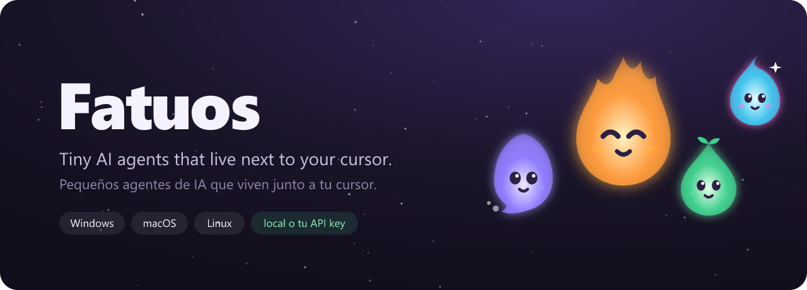
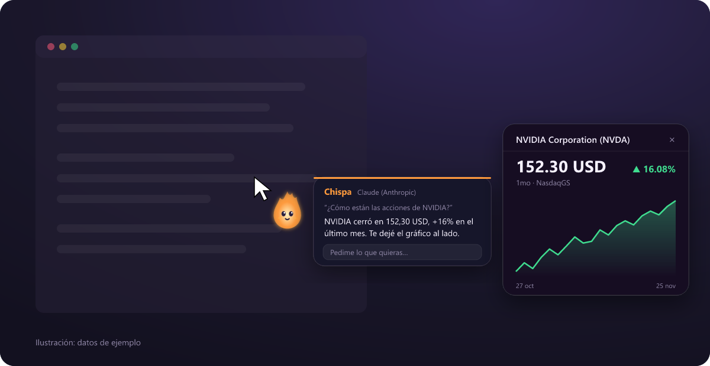
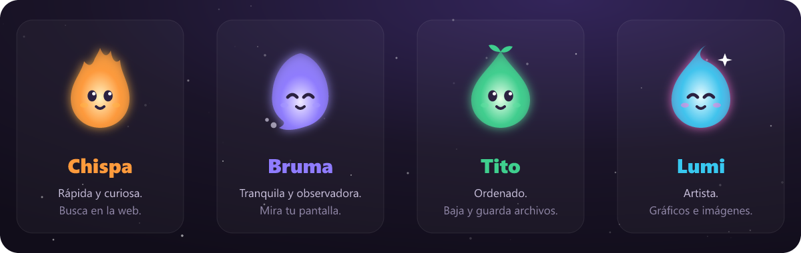

<p align="center">
  
</p>

<p align="center">
  <a href="README.md">Español</a> · <b>English</b>
</p>

---

**Fatuos** is an AI assistant with no window. Its face is a set of **tiny characters**, the *fatuos* (will-o'-the-wisps), that pop up next to your mouse now and then, say hi and fade away. They are **agents**: ask them for something and they do it. They can draw a live stock chart on your screen, download an image, show you what you asked for, or look at what you circled on your screen.

They run on **local models** (Ollama, LM Studio) or **your own API key** (Claude, OpenAI, Gemini, NVIDIA and more). Keys live in your OS keychain.

<p align="center">
  
</p>

## What it does

| You say… | The fatuo… |
|---|---|
| “How is NVIDIA stock doing?” | fetches the live price and **draws a floating chart** |
| “Download a picture of a cow” | finds one and saves it to `Desktop/Fatuos/downloads` |
| “Show me a pig” | **shows it on screen**, nothing saved |
| **Alt+Space** → draw on screen → “what is this?” | **freezes your screen**, sees your marks and answers |
| “Generate an astronaut cat” | creates it with AI (with an OpenAI or Gemini key) |

## The characters

<p align="center"></p>

## The hidden menu

Fatuos lives in the system tray (Windows: the **^** *show hidden icons* arrow · macOS: menu bar · Linux: AppIndicator). **Right-click → Mostrar menú** opens everything: characters, model, shortcuts, folder and credits. Left-click summons a fatuo.


## Models

Ollama · LM Studio · Claude (Anthropic) · OpenAI · Google Gemini · NVIDIA NIM · OpenRouter · Groq · any OpenAI-compatible endpoint · Claude Code CLI · OpenCode CLI.

## Shortcuts

`Alt+D` summon · `Alt+Space` look at my screen · `Esc` dismiss · `Ctrl+Z` undo a stroke.

## Install

Grab the installer from **[Releases](https://github.com/juanipro1979/fatuos/releases)**: `.msi`/`.exe` (Windows), `.dmg` (macOS: unsigned, so right-click → Open the first time), `.AppImage`/`.deb` (Linux).

## Build from source

```bash
git clone https://github.com/juanipro1979/fatuos
cd fatuos
npm install
npm run tauri dev
```

Requires Rust, Node 20+ and the [Tauri prerequisites](https://tauri.app/start/prerequisites/).

## Security

API keys go to the OS keychain. Downloads can only land in `Desktop/Fatuos/downloads`. The model cannot run shell commands.

## Credits

Idea by [juanipro1979](https://github.com/juanipro1979) · built together with Claude (Anthropic) · original characters · made with Tauri, Rust, React and TypeScript · [MIT](LICENSE).
