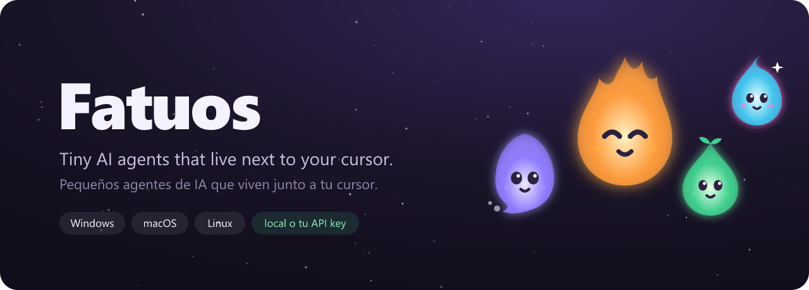
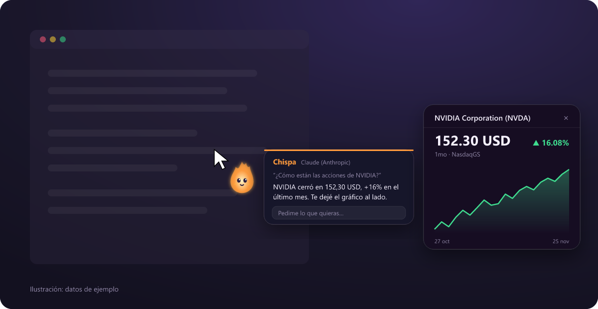
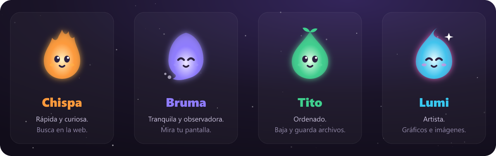

<p align="center">
  
</p>

<p align="center">
  <b>Español</b> · <a href="README.en.md">English</a>
</p>

<p align="center">
  <a href="https://github.com/juanipro1979/fatuos/releases"></a>
  
  
  
</p>

---

**Fatuos** es un asistente de IA que no tiene ventana. Su cara son unos **mini personajes**, los fatuos, que aparecen junto a tu mouse cada tanto, te saludan y se desvanecen. Son **agentes**: les pedís algo y lo hacen. Te dibujan el precio de una acción en la pantalla, te bajan una imagen, te muestran lo que buscás o miran lo que marcaste en tu pantalla.

Funcionan con **modelos locales** (Ollama, LM Studio) o con **tu propia API key** (Claude, OpenAI, Gemini, NVIDIA y más). Tus keys quedan en el llavero de tu sistema.

> El nombre viene de los *fuegos fatuos*: las lucecitas de las leyendas que aparecen de la nada, te muestran el camino y se apagan.

<p align="center">
  
</p>

## ✨ Qué hace

| Le decís… | El fatuo… |
|---|---|
| “¿Cómo están las acciones de NVIDIA?” | busca el precio en vivo y **dibuja un gráfico flotante** con la variación |
| “Descargame una imagen de una vaca” | la busca y la guarda en `Escritorio/Fatuos/downloads` |
| “Mostrame un chancho” | te la **muestra en pantalla** sin guardar nada |
| **Alt+Espacio** → dibujás encima → “¿qué es esto?” | **congela tu pantalla**, ve tus marcas y te responde |
| “Bitcoin del último año” | gráfico de BTC-USD a 1 año |
| “Buscá el clima de mañana en Córdoba” | busca en la web y te lo resume |
| “Generá un gato astronauta” | lo crea con IA (si tenés key de OpenAI o Gemini) |

## 🔥 Los fatuos

<p align="center">
  
</p>

Los cuatro pueden hacer de todo. La diferencia es de personalidad. En el menú elegís uno fijo o dejás que aparezca cualquiera.

## 🫥 El menú se esconde

Fatuos vive en la bandeja del sistema:

- **Windows:** en la flechita **^** de *Mostrar iconos ocultos*, al lado del reloj.
- **macOS:** en la barra de menú de arriba.
- **Linux:** en el área de indicadores (en GNOME hace falta la extensión *AppIndicator*).

**Clic derecho → Mostrar menú** abre todo: fatuos, modelo, atajos, carpeta y créditos. Clic izquierdo llama a un fatuo.


## 🧠 Modelos

| Proveedor | Tipo | Qué necesitás |
|---|---|---|
| **Ollama** | local | [Ollama](https://ollama.com) instalado + `ollama pull llama3.2` |
| **LM Studio** | local | [LM Studio](https://lmstudio.ai) con el servidor encendido |
| **Claude** (Anthropic) | API | API key |
| **OpenAI** | API | API key |
| **Google Gemini** | API | API key |
| **NVIDIA NIM** | API | API key de build.nvidia.com |
| **OpenRouter** · **Groq** | API | API key |
| **Proveedor personalizado** | API | cualquier URL compatible con OpenAI |
| **Claude Code** | CLI | el comando `claude` instalado |
| **OpenCode** | CLI | el comando `opencode` instalado |

En **Menú → Modelo** elegís el proveedor, tocás *Ver modelos* para traer la lista y *Probar conexión* para chequear que anda.

> Los modelos locales chicos a veces no saben usar herramientas. Para esos casos, Fatuos tiene un protocolo de texto que les explica cómo pedirlas.

## ⌨️ Atajos

| Atajo | Acción |
|---|---|
| `Alt+D` | Llamar a un fatuo junto al cursor |
| `Alt+Espacio` | Congelar la pantalla, dibujar y preguntar |
| `Esc` | Despedir al fatuo o cancelar la captura |
| `Ctrl+Z` | Deshacer un trazo en la captura |

## 📦 Instalación

Bajá el instalador para tu sistema desde **[Releases](https://github.com/juanipro1979/fatuos/releases)**:

- **Windows:** `.msi` o `.exe`
- **macOS:** `.dmg` (Apple Silicon e Intel). Como no está firmada, la primera vez abrila con **clic derecho → Abrir**. Para usar Alt+Espacio, dale permiso de *Grabación de pantalla*.
- **Linux:** `.AppImage` o `.deb`

## 🛠️ Compilar desde el código

Necesitás [Rust](https://rustup.rs), [Node 20+](https://nodejs.org) y las [dependencias de Tauri](https://tauri.app/start/prerequisites/) de tu sistema.

```bash
git clone https://github.com/juanipro1979/fatuos
cd fatuos
npm install
npm run tauri dev     # modo desarrollo
npm run tauri build   # instalador
```

## 🏗️ Cómo está hecho

```
src-tauri/   Rust: bandeja, overlay transparente, atajos globales, captura,
             descargas confinadas, llavero del sistema, CLIs
src/
  overlay/   fatuos animados, globito de chat, gráficos, imágenes, captura
  menu/      ventana del menú y créditos
  agent/     bucle de agente + proveedores (Anthropic SDK, OpenAI-compatible,
             Gemini, CLIs) + herramientas
```

- El **overlay** es una ventana transparente del tamaño de tu pantalla. Los clics la atraviesan, salvo encima de un fatuo o de un widget: Rust sigue al cursor y activa o desactiva el paso del mouse según dónde está.
- Las **herramientas** usan fuentes sin key: Yahoo Finance (bolsa), Openverse y Wikimedia Commons (imágenes) y DuckDuckGo (búsqueda).

## 🔒 Privacidad y seguridad

- Las API keys van al **llavero del sistema** (Credential Manager, Keychain o Secret Service).
- Las descargas **solo** pueden ir a `Escritorio/Fatuos/downloads`. Los nombres de archivo se limpian para que no puedan escaparse de esa carpeta.
- El modelo **no** puede correr comandos en tu compu.
- Con un modelo local, nada sale de tu máquina salvo las búsquedas que pidas.

## ⚠️ Limitaciones conocidas

- **Linux con Wayland:** la posición global del mouse y el paso de clics están limitados. Con X11 anda completo.
- Por ahora la app se probó a mano solo en Windows. macOS y Linux se compilan en CI.

## 🙌 Créditos

- **Idea:** [juanipro1979](https://github.com/juanipro1979)
- **Diseño y código:** hecho junto con Claude (Anthropic)
- **Personajes:** Chispa, Bruma, Tito y Lumi, originales de Fatuos
- **Hecho con:** [Tauri](https://tauri.app), Rust, React y TypeScript

## 📄 Licencia

[MIT](LICENSE)
